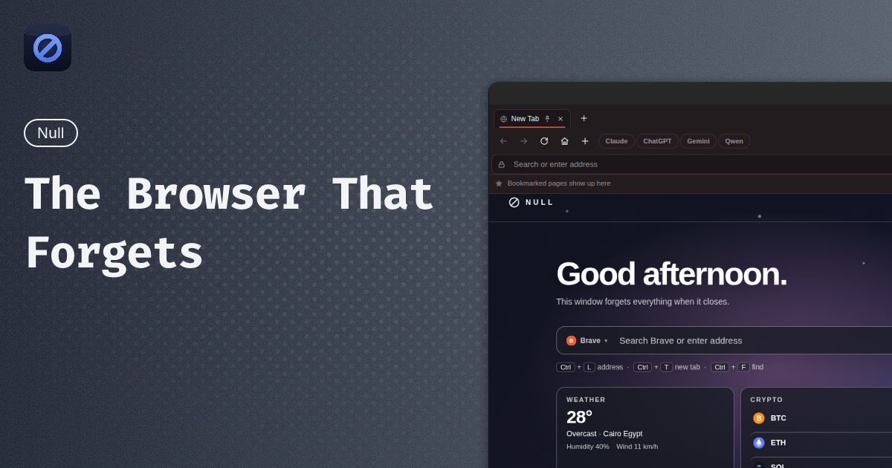

# ∅ Null — The Browser That Forgets

> A privacy-focused desktop browser that forgets everything when it closes.
> No telemetry. No account. No cloud. Just browsing.

[](https://github.com/abdalla-3077/null/releases)
[](https://github.com/abdalla-3077/null/actions/workflows/release.yml)
[](https://github.com/abdalla-3077/null/actions/workflows/ci.yml)
[](https://www.electronjs.org/)
[](https://react.dev/)
[](LICENSE)




---

## ✨ Why Null?

Most browsers remember everything. Null remembers **nothing** — unless you ask it to.

- 🛡️ **Session-only by design** — bookmarks, history and session data live in memory and vanish on quit
- 🚨 **Emergency escape** — one click jumps to a safe page (Google, blank, or your own URL)
- 🤖 **Built-in AI panel** — ChatGPT, Claude, Gemini, Qwen, plus your own custom providers
- 🎭 **Device-profile spoofing** — per-tab desktop + mobile user-agent profiles
- 🔒 **Explicit permissions** — camera, mic, location, notifications, clipboard, MIDI and screen sharing all ask first; unknown = denied
- 🔐 **HTTPS-first** — plain HTTP is upgraded to HTTPS, falling back only with the usual warning
- ⌨️ **Command palette** — `Ctrl/⌘ + K` for everything: tabs, actions, views, privacy

## 📸 Tour

| Home dashboard | Smart address bar | Command palette |
|---|---|---|
| Greeting, private-search picker, keyless weather card + live BTC/ETH/SOL prices, quick links | Auto-detects URLs vs. search queries · 8 engines ranked most-private-first | Fuzzy access to tabs, actions, views and privacy (`Ctrl/⌘ + K`, `Ctrl/⌘ + Shift + A` for tabs) |

> Screenshot above: the Null home screen (`null://newtab`). The repo hero image lives at `MD/Md.png` — please keep it current when the home screen changes.

## 📦 Download

Grab the latest installer from [**Releases**](https://github.com/abdalla-3077/null/releases) — every release ships an emoji-grouped changelog (✨🐛🔒⚡♻️📝💄✅🔧) plus all platform builds:

| OS | File | Install |
|---|---|---|
| 🪟 Windows | `Null-*-Setup.exe` | Run the Setup wizard |
| 🍎 macOS | `Null-*.zip` | Unzip → drag **Null** to Applications |
| 🐧 Debian / Ubuntu | `null_*.deb` | `sudo dpkg -i null_*.deb` |
| 🐧 Fedora / RHEL | `null-*.rpm` | `sudo rpm -i null-*.rpm` |

Pre-releases (`v1.0.0-beta.1` style tags) are marked as such on the Releases page.

## 🚀 Quick start (developers)

**Prerequisites:** Node.js 20+ and npm.

```bash
npm ci
npm start        # run in development
```

| Script | What it does |
|---|---|
| `npm start` | Run in development |
| `npm run package` | Package the app |
| `npm run make` | Build installers into `out/` |
| `npm run lint` | ESLint (TS/React) |

## 🧩 Features

- **Tabbed browsing** — top / side / bottom layouts, pinned tabs, reopen closed tabs, multi-window
- **Smart address bar** — URL vs. search detection, configurable engine (Google, Bing, DuckDuckGo + 5 more private engines)
- **Bookmarks & history** — one-click star + searchable history page. Session-only, never touches disk
- **Zoom controls** — per-tab zoom with address-bar chip and `Ctrl/⌘ + +/-/0`
- **Download manager** — progress tray with pause / resume / cancel + configurable location
- **Find in page** — match counts and navigation
- **Internal pages** — `null://newtab`, `null://settings`, `null://error/*` over a privileged custom protocol
- **Theming** — light/dark + blue, red, neutral themes; Dark Reader-style force-dark filter
- **Page translation** — toolbar button translates in place via Google Translate, one-click restore
- **Setup wizard** — first-run onboarding for layout, theme, search and privacy defaults

## ⌨️ Shortcuts

| Shortcut | Action |
|---|---|
| `Ctrl/⌘ + T` | New tab |
| `Ctrl/⌘ + W` | Close tab |
| `Ctrl/⌘ + Shift + T` | Reopen closed tab |
| `Ctrl/⌘ + L` | Focus address bar |
| `Ctrl/⌘ + R` / `Shift + R` | Reload / hard reload |
| `Ctrl/⌘ + F` | Find in page |
| `Ctrl/⌘ + K` | Command palette |
| `Ctrl/⌘ + Shift + A` | Search tabs |
| `Ctrl/⌘ + D` | Bookmark this page |
| `Ctrl/⌘ + H` | History |
| `Ctrl/⌘ + J` | Downloads |
| `Ctrl/⌘ + +` / `-` / `0` | Zoom in / out / reset |
| `Ctrl/⌘ + Tab` | Next / previous tab |
| `Ctrl/⌘ + Shift + Del` | Clear session data |
| `Esc` | Stop / dismiss |

## 🏗️ Tech stack

| Layer | Tech |
|---|---|
| Shell | Electron 44 + Electron Forge |
| UI | React 19 + Zustand + Vite |
| Main | TypeScript (`src/main/*`: tabs, windows, IPC) |
| Storage | `electron-store` (settings, tab restore) |
| Build | Vite (main / preload / renderer) + TS |
| Packaging | Squirrel (Win), ZIP (macOS), deb/rpm (Linux) |

```
src/
├── main.ts                 # App boot, menu, protocol registration
├── preload.ts              # Secure IPC bridge (window.nullBrowser / nullSettings)
├── main/
│   ├── window-manager.ts   # BrowserWindow + BrowserView layout
│   ├── tab-manager.ts      # Tab lifecycle, navigation, restore
│   ├── download-manager.ts # Download tracking
│   ├── ai-panel-manager.ts # AI side panel views
│   ├── privacy-manager.ts  # Session cleanup
│   ├── settings-store.ts   # Persisted settings
│   ├── null-protocol.ts    # null:// internal pages
│   └── ipc/                # IPC handlers
├── renderer/               # React UI (toolbar, tabs, settings, wizard…)
└── shared/                 # types + search engines, AI providers, UA profiles
```

## 🛡️ Security & privacy notes

- Context isolation is **on**; the renderer talks to main only through a minimal preload IPC bridge.
- Electron fuses enabled (`RunAsNode: false`, ASAR integrity validation, app-only-from-ASAR).
- The `null://` scheme is registered as privileged / standard / secure.
- See [`CHANGELOG.md`](CHANGELOG.md) for per-release security fixes (🔒 section).

## 🤝 Contributing

1. Fork → branch (`feat/...`, `fix/...`, `docs/...` — see `AGENTS.md` for the full prefix → emoji map).
2. Keep PR titles Conventional-Commit style — squash-merge preserves the title for the changelog.
3. `npm run lint` + `npx tsc --noEmit` must pass (CI enforces this).
4. Screenshots with personal data must be redacted. Never commit secrets or `.env` contents.
5. Releases are automated: maintainers tag `v*.*.*` and the **🚀 Release Build** workflow builds all platforms, writes the emoji changelog, attaches installers and updates `CHANGELOG.md`.

## 📜 Changelog & 📄 License

- Changelog: [`CHANGELOG.md`](CHANGELOG.md) + the [Releases page](https://github.com/abdalla-3077/null/releases)
- License: MIT — see [LICENSE](LICENSE) *(adding with first public release if missing)*

---

<p align="center">Made with care for people who close the window and mean it. ∅</p>
